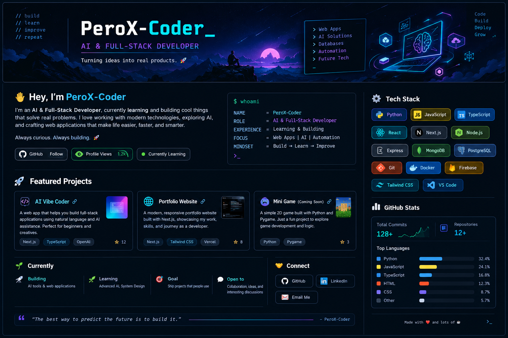

<!--
  PeroX-Coder | GitHub Profile README
  Replace every [PLACEHOLDER] and remove sections that do not fit.
-->

  

  
  
  

  

---

## `> whoami`

Hey, I'm **PeroX-Coder** 👋

I'm an **AI & Full-Stack Developer in progress**, learning by building projects, experimenting with new tools, and turning ideas into useful software.

I'm a 13 years old boy with limitless curiosity behind the AI Metaverse and AI/ML Technologies!

- 🔭 **Building:** [...]
- 🌱 **Learning:** C, JavaScript, HTML, Python, React, Node.js, Git
- 🧪 **Exploring:** AI-powered apps, web development, and automation
- 🎯 **Goal:** Ship useful projects, understand how they work, and keep improving
- 🤝 **Open to:** Collaboration, feedback, and interesting project ideas

> `Build → Break → Understand → Improve`

## ⚡ Tech Stack

_I'm learning these technologies and stacks._

  <!-- Starter badges: remove anything you have not tried yet. -->
  
  
  
  
  
  

## 🚀 Featured Projects

<!-- Replace each placeholder with a real repository URL and an honest description. -->

<table>
  <tr>
    <td width="50%">
      <h3>🤖 LumoCoder</h3>
      
An AI Vibe Coder built in Google AI Studio. Use Gemini Models to build apps in lumoCoder.

      <a href="https://github.com/PeroX-Coder/LumoCoder">View repository ↗</a>
    </td>
    <td width="50%">
      <h3>🌐 VibeStack</h3>
      
Aesthetic and cool, also working Monaco Code Editor Project with smooth transtions.

      <a href="https://github.com/PeroX-Coder/VibeStack">View repository ↗</a>
    </td>
  </tr>
  <tr>
    <td width="50%">
      <h3>🧰 Arzo</h3>
      
A learning experiment with my ChatGPT Codex.

      <a href="https://github.com/PeroX-Coder/Arzo">View repository ↗</a>
    </td>
    <td width="50%">
      <h3>🛠️ Next up</h3>
      
I'm always experimenting with new ideas. Check back as I turn more of them into working projects.

      <a href="https://github.com/PeroX-Coder?tab=repositories">Explore all repositories ↗</a>
    </td>
  </tr>
</table>

## 📈 GitHub Activity

<!-- These cards are served by a third-party service and may occasionally be unavailable. -->

  
  

## 🤝 Connect

  
  <!-- Add only profiles you actively use. -->
   Mail me on : rekore200@gmail.com

---

  <i>“The best way to predict the future is to build it.”</i> 
  Made by PeroX-Coder · Always learning, always building.

<!--
**PeroX-Coder/PeroX-Coder** is a ✨ _special_ ✨ repository because its `README.md` (this file) appears on your GitHub profile.

Here are some ideas to get you started:

- 🔭 I’m currently working on ...
- 🌱 I’m currently learning ...
- 👯 I’m looking to collaborate on ...
- 🤔 I’m looking for help with ...
- 💬 Ask me about ...
- 📫 How to reach me: ...
- 😄 Pronouns: ...
- ⚡ Fun fact: ...
-->
